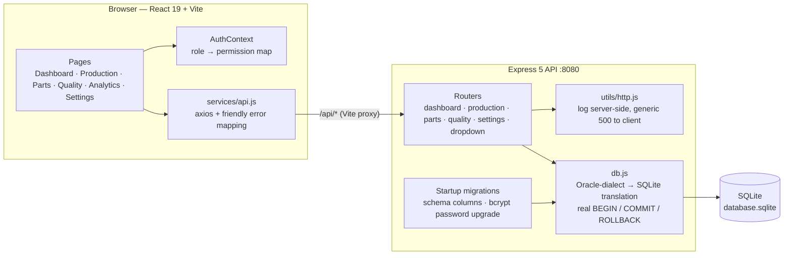

<div align="center">

<a href="https://techmines.github.io/"></a>

# AutoLine

**Car-manufacturing operations platform — production, inventory, quality and workforce in one control room.**

[](https://github.com/TECHMINEs/AutoLine/actions/workflows/ci.yml)


</div>

AutoLine gives a vehicle plant a single dashboard for daily production output, parts inventory, line-side consumption and quality testing, with role-based views for admins, managers and operators. It turns raw shop-floor entries into live KPIs, low-stock alerts and defect analytics so problems surface before they stop a line.

*Built as a Database Systems (DBS) course project, originally on Oracle and now running on SQLite through a dialect translation layer.*

---

## Architecture



## Tech Stack

- **Frontend:** React 19, React Router 7, Vite 7, Tailwind CSS 4, Recharts 3, lucide-react, axios
- **Backend:** Node.js 20, Express 5, `sqlite` / `sqlite3`, bcryptjs, PDFKit
- **Database:** SQLite (schema and seed data in `database_schema.sql`)
- **Tooling:** ESLint 9 (react-hooks, react-refresh), GitHub Actions CI

## Local Setup

**Prerequisites:** Node.js 20+ and npm 10+.

```bash
git clone https://github.com/TECHMINEs/AutoLine.git
cd AutoLine
```

**1. Backend (API on http://localhost:8080)**

```bash
cd backend
npm install
cp .env.example .env
node server.js
```

On first start the API runs idempotent migrations: it adds any missing schema columns and re-hashes any plaintext seed passwords with bcrypt.

**2. Frontend (app on http://localhost:3000)**

```bash
cd frontend
npm install
npm run dev
```

The Vite dev server proxies `/api/*` to the backend, so no CORS setup is needed. If the API runs on another port, set `AUTOLINE_API_URL`, for example `PORT=8090 node server.js` with `AUTOLINE_API_URL=http://localhost:8090 npm run dev`.

**Demo accounts** (from the seed data — change them for any shared deployment):

| Role | Username | Password |
|---|---|---|
| Admin | `admin` | `admin` |
| Manager | `manager` | `manager` |
| Supervisor | `supervisor1` | `super` |
| Inspector | `inspector1` | `inspect` |
| Operator | `user1` | `password` |

**Reset the database** to the seed state (destructive):

```bash
cd backend
node init_db.js
```

**Production build:** `cd frontend && npm run build` outputs static files to `frontend/dist/`.

## Key Features

- **Live KPI dashboard:** total production, inventory value, defect rate and a production trend chart.
- **Automatic parts consumption:** logging a production run inserts the matching parts usage from the bill of materials, so no manual entry is needed.
- **Parts inventory:** stock levels against minimums, with OK / LOW / OUT filtering and search.
- **Transactional bulk stock updates and purchase orders:** all-or-nothing, so a failure never leaves stock half-updated. Orders come with PDF bills.
- **Quality testing:** per-line and per-model defect analytics with threshold highlighting.
- **Notification centre:** auto-refreshes every 60 seconds and shows critical/warning alerts for out-of-stock parts and high defect rates. It reports "status unavailable" instead of a false "all clear" when the API is unreachable.
- **Role-based UI:** admin, manager and operator permission sets gate editing, bulk operations and settings.
- **Master data management:** production lines, car models and employees.
- **Security:** bcrypt password storage with transparent migration from legacy plaintext, and no raw database errors exposed to clients.

## Engineering Highlights

- **Oracle → SQLite portability layer.** The routes were written against Oracle (`NVL`, `SYSDATE`, `TRUNC`, sequences, `:named` binds). `db.js` translates that dialect to SQLite at query time, so the original SQL runs unchanged on a zero-setup embedded database.
- **Real transactions on top of a translation layer.** `begin()`, `commit()` and `rollback()` issue real SQLite transactions, and `close()` rolls back anything left open. Bulk updates validate every line item before touching data.
- **Safe, idempotent startup migrations.** Missing columns are detected with `pragma_table_info` and added. Plaintext credentials are re-hashed in place, so existing users keep working with no manual step.
- **Defensive data fetching.** Pages load through a cancellable `useLoadOnChange` hook, which avoids StrictMode double-fetches and cascading renders. All errors go through one `getErrorMessage` mapper, so users never see raw stack traces.
- **Explicit column contracts.** List endpoints return explicit column lists in a documented order. This prevents the silent column drift that `SELECT *` caused between the database schema and the index-based UI.

## Known Limitations

- **No API authentication:** login only identifies the user to the UI, so anyone who can reach port 8080 can call it. Add session or JWT middleware before exposing it beyond localhost.
- **Single-node storage:** SQLite suits a single plant workstation or a demo, not concurrent multi-site writes.

---

<div align="center">

Created by **Pranav Jangid** | [**TECHMINES**](https://github.com/TECHMINEs)

</div>
